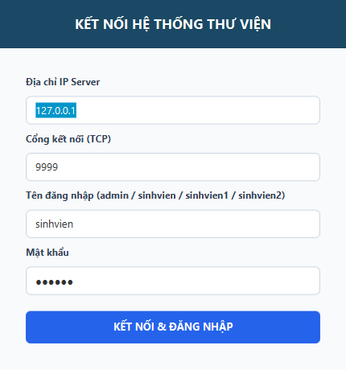
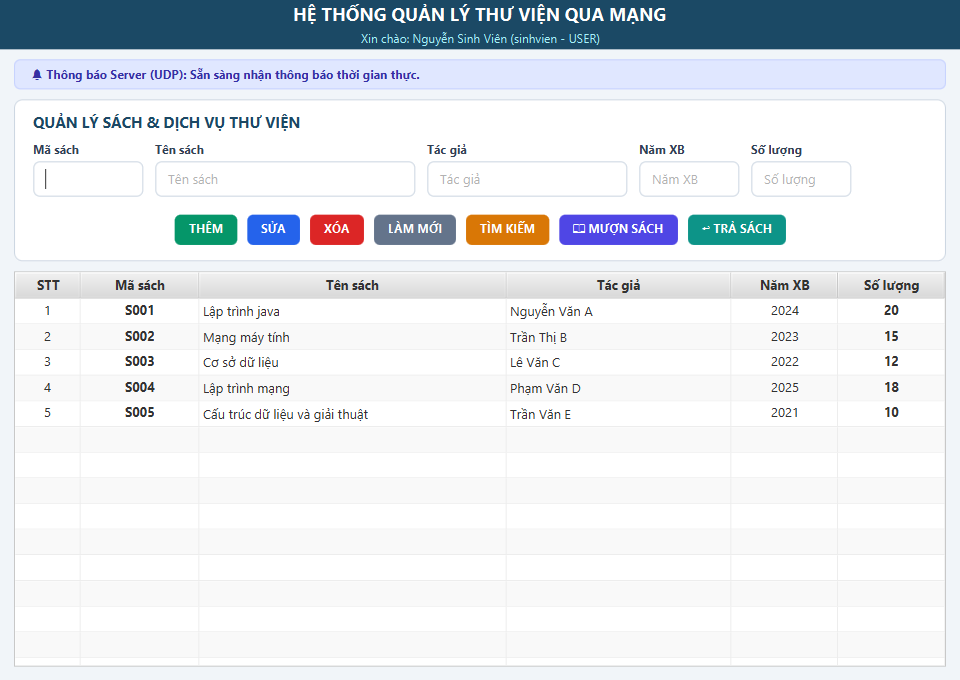
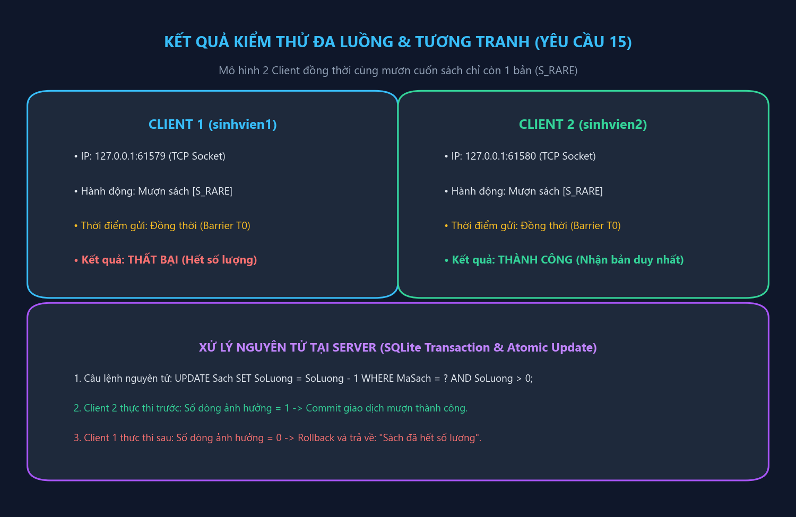
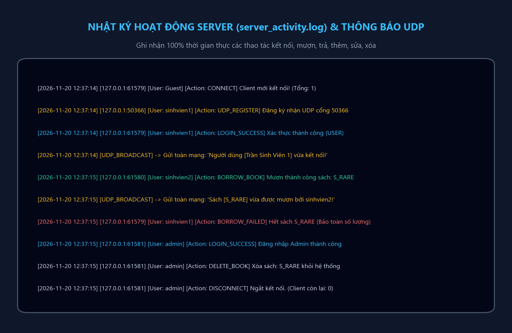

# 📚 Hệ Thống Quản Lý Thư Viện Qua Mạng (Network Library Management System)

> **Mô hình kiến trúc Client - Server đa luồng (Multi-threaded TCP/UDP Socket) kết hợp cơ sở dữ liệu SQLite và giao diện đồ họa hiện đại JavaFX.**

---

## 📌 Giới thiệu tổng quan

**Network Library Management System** là ứng dụng quản lý thư viện sách tập trung phân tán được xây dựng theo kiến trúc Client - Server. Hệ thống cho phép nhiều máy trạm (Client) kết nối đồng thời tới một máy chủ trung tâm (Server) để thực hiện các thao tác quản lý kho sách, tra cứu, mượn và trả sách theo thời gian thực.

Ứng dụng kết hợp linh hoạt giữa giao thức **TCP Socket** (đảm bảo tính tin cậy tuyệt đối cho các giao dịch nghiệp vụ) và **UDP Socket** (phát tin thông báo đẩy thời gian thực tới tất cả các trạm đang hoạt động). Toàn bộ dữ liệu được lưu trữ tập trung tại CSDL nhúng SQLite với cơ chế kiểm soát giao dịch nghiêm ngặt nhằm chống xung đột dữ liệu (Race Condition).

---

## ✨ Tính năng nổi bật

### 1. 🔐 Xác thực & Phân quyền người dùng (Authentication & Access Control)
- Đăng nhập an toàn qua mạng: Thông tin tài khoản được máy chủ xác thực qua cơ sở dữ liệu.
- Phân quyền vai trò người dùng: Quản trị viên (`ADMIN`) và Người dùng / Sinh viên (`USER`).
- Hỗ trợ đăng xuất an toàn (`Logout`) và đổi tài khoản nhanh chóng ngay trên giao diện mà không cần tắt ứng dụng.

### 2. 📖 Quản lý danh mục sách toàn diện (Book Management - CRUD)
- **Xem danh mục:** Tải và hiển thị danh sách sách dạng bảng trực quan (`Mã sách`, `Tên sách`, `Tác giả`, `Năm xuất bản`, `Số lượng tồn kho`).
- **Thêm mới:** Kiểm tra tính hợp lệ dữ liệu, ngăn chặn trùng lặp mã sách.
- **Cập nhật & Chỉnh sửa:** Sửa đổi thông tin sách, tự động đồng bộ lên máy chủ.
- **Xóa sách:** Xóa đầu sách khỏi hệ thống với ràng buộc toàn vẹn (không xóa sách khi đang có người mượn).
- **Tìm kiếm:** Tra cứu sách theo từ khóa (tên sách, tác giả) với tốc độ phản hồi tức thì.

### 3. 🔄 Nghiệp vụ Mượn & Trả sách trực tuyến (Borrow & Return Management)
- Cho phép người dùng mượn sách trực tiếp: Tự động trừ số lượng tồn kho và tạo bản ghi phiếu mượn thời gian thực.
- Cho phép trả sách: Tự động hoàn lại số lượng sách vào kho và ghi nhận thời gian trả.
- Ràng buộc nghiệp vụ chặt chẽ:
  - Không cho phép mượn khi sách đã hết số lượng (`Số lượng = 0`).
  - Mỗi tài khoản không được mượn trùng lặp cuốn sách khi chưa hoàn trả.
  - Không thể thực hiện trả cuốn sách chưa từng được mượn.

### 4. ⚡ Đồng bộ dữ liệu tức thời qua UDP Broadcast (Real-time Synchronization)
- Ứng dụng triển khai cơ chế **Push Notification** qua UDP Socket (cổng `9998`).
- Bất cứ khi nào một Client thực hiện thao tác làm thay đổi dữ liệu (Thêm / Sửa / Xóa / Mượn / Trả), Server lập tức phát gói tin UDP tới toàn bộ các Client khác đang online.
- Các Client nhận thông báo và **tự động làm mới bảng dữ liệu** ngay trên màn hình mà người dùng không cần phải bấm nút *Làm mới*.

### 5. 🛡️ Kiểm soát tương tranh & Bảo đảm tính nhất quán (Concurrency Control)
- Xử lý triệt để bài toán **Race Condition** khi nhiều Client đồng thời gửi yêu cầu mượn cuốn sách cuối cùng (`Số lượng = 1`).
- Áp dụng cơ chế bảo vệ kép:
  1. **Đồng bộ hóa đa luồng Java (`synchronized`):** Quản lý luồng truy cập phương thức nghiệp vụ.
  2. **Giao dịch nguyên tử SQLite (`BEGIN IMMEDIATE TRANSACTION`):** Đảm bảo tính ACID, khóa bản ghi trước khi đọc-ghi. Giao dịch hợp lệ đầu tiên sẽ thành công, các yêu cầu đến sau sẽ nhận thông báo sách đã hết một cách an toàn.

### 6. 📝 Ghi nhật ký máy chủ tập trung (System Logging)
- Máy chủ tự động ghi lại toàn bộ hoạt động ra tệp tin `server_activity.log`.
- Định dạng chuẩn hóa: Nhãn thời gian thực `[yyyy-MM-dd HH:mm:ss]`, địa chỉ IP, cổng kết nối, tài khoản thao tác, mã lệnh và trạng thái xử lý.

---

## 🛠️ Công nghệ & Kỹ thuật sử dụng

| Phân hệ | Công nghệ / Thư viện | Vai trò |
| :--- | :--- | :--- |
| **Ngôn ngữ** | Java (JDK 17+) | Nền tảng phát triển ứng dụng chính |
| **Giao diện người dùng** | JavaFX (Controls, Graphics, Base) | Xây dựng GUI hiện đại, mượt mà và trực quan |
| **Giao tiếp mạng** | Java Socket TCP (`java.net.Socket`, `ServerSocket`) | Kênh truyền thông tin cậy cho các tác vụ Client - Server |
| **Thông báo đẩy** | UDP Socket (`DatagramSocket`, `DatagramPacket`) | Truyền phát thông báo đồng bộ dữ liệu thời gian thực |
| **Xử lý đa luồng** | `ExecutorService`, `Thread`, `AtomicInteger` | Phục vụ nhiều Client đồng thời không gây nghẽn (Non-blocking) |
| **Cơ sở dữ liệu** | SQLite 3 (`library.db`) & SQLite JDBC Driver | Hệ quản trị CSDL nhúng nhẹ, tin cậy, hỗ trợ giao dịch ACID |
| **Kiểm soát tương tranh** | Multi-level Locking & SQLite Atomic Transactions | Ngăn chặn tranh chấp dữ liệu khi nhiều Client thao tác cùng lúc |

---

## 🏛️ Kiến trúc hệ thống & Luồng hoạt động

```
+-------------------------------------------------------------------+
|                        MÁY CHỦ TRUNG TÂM                          |
|                       (LibraryServer.java)                        |
|                                                                   |
|   +-----------------------+            +----------------------+   |
|   |  TCP ServerSocket     |            |  UDP DatagramSocket  |   |
|   |     (Port 9999)       |            |     (Port 9998)      |   |
|   +-----------+-----------+            +-----------+----------+   |
|               |                                    |              |
|        Pool đa luồng                               | Broadcast    |
|       (ClientHandler)                              | thông báo    |
|               |                                    |              |
|   +-----------v-----------+                        |              |
|   |     DatabaseHelper    |                        |              |
|   | (Atomic Transactions) |                        |              |
|   +-----------+-----------+                        |              |
|               |                                    |              |
|        +------v------+                             |              |
|        |  SQLite DB  |                             |              |
|        |(library.db) |                             |              |
|        +-------------+                             |              |
+---------------+------------------------------------+--------------+
                ^ (TCP Request / Response)           | (UDP Push)
                |                                    v
+---------------+------------------------------------+--------------+
|                     CÁC MÁY TRẠM (CLIENTS)                        |
|                                                                   |
|   +---------------------------+    +--------------------------+   |
|   |         CLIENT 1          |    |         CLIENT 2         |   |
|   |  • ConnectFrame (Login)   |    |  • ConnectFrame (Login)  |   |
|   |  • BookFrame (Main GUI)   |    |  • BookFrame (Main GUI)  |   |
|   |  • NetworkClient          |    |  • NetworkClient         |   |
|   |  • UDPListener Thread     |    |  • UDPListener Thread    |   |
|   +---------------------------+    +--------------------------+   |
+-------------------------------------------------------------------+
```

---

## 📡 Đặc tả giao thức truyền thông (Protocol Specification)

| Lệnh (Command) | Tham số gửi từ Client | Phản hồi từ Server | Ý nghĩa nghiệp vụ |
| :--- | :--- | :--- | :--- |
| `LOGIN` | `LOGIN <Username> <Password> <UDP_Port>` | `SUCCESS <HoTen> <Role>` / `ERROR <Lý do>` | Xác thực tài khoản & đăng ký cổng UDP |
| `LIST` | `LIST` | `SUCCESS <Dữ liệu sách>` | Lấy toàn bộ danh mục sách |
| `SEARCH` | `SEARCH <Từ khóa>` | `SUCCESS <Dữ liệu sách>` | Tìm kiếm sách theo từ khóa |
| `ADD` | `ADD <Ma>\|<Ten>\|<TacGia>\|<Nam>\|<SL>` | `SUCCESS` / `ERROR <Lý do>` | Thêm mới một cuốn sách |
| `UPDATE` | `UPDATE <Ma>\|<Ten>\|<TacGia>\|<Nam>\|<SL>` | `SUCCESS` / `ERROR <Lý do>` | Cập nhật thông tin cuốn sách |
| `DELETE` | `DELETE <MaSach>` | `SUCCESS` / `ERROR <Lý do>` | Xóa một cuốn sách khỏi thư viện |
| `BORROW` | `BORROW <MaSach>` | `SUCCESS` / `ERROR <Lý do>` | Mượn sách (có kiểm tra tồn kho & tương tranh) |
| `RETURN` | `RETURN <MaSach>` | `SUCCESS` / `ERROR <Lý do>` | Hoàn trả cuốn sách đã mượn |
| `QUIT` | `QUIT` | Đóng kết nối | Ngắt kết nối socket an toàn |

---

## 🖼️ Hình ảnh minh họa hoạt động

### 1. Giao diện kết nối & Đăng nhập
Màn hình xác thực tài khoản người dùng, cấu hình địa chỉ IP máy chủ và cổng kết nối, tích hợp các phím chọn nhanh tài khoản thử nghiệm:



---

### 2. Giao diện chính Quản lý thư viện
Bảng điều khiển trực quan hỗ trợ đầy đủ các tính năng nhập liệu, các nút bấm thao tác và danh sách sách thời gian thực:



---

### 3. Kiểm thử đa Client chạy song song & Đồng bộ thời gian thực
Thực nghiệm 2 máy trạm hoạt động song song. Khi Client bên trái thực hiện mượn sách, Client bên phải lập tức nhận được thông báo UDP Broadcast và bảng dữ liệu tự động cập nhật:



---

### 4. Hệ thống ghi nhật ký hoạt động (Server Activity Log)
Mọi kết nối, xác thực và giao dịch được máy chủ kiểm soát và ghi chi tiết vào tệp nhật ký:



---

## 📁 Cấu trúc thư mục dự án

```text
├── src/
│   ├── LibraryServer.java       # Máy chủ TCP & UDP đa luồng, xử lý ghi nhật ký log
│   ├── ClientHandler.java       # Bộ xử lý kết nối cho từng Client trên một luồng riêng
│   ├── DatabaseHelper.java      # Tầng truy xuất CSDL SQLite, kiểm soát giao dịch nguyên tử
│   ├── NetworkClient.java       # Tầng kết nối mạng phía Client (TCP Socket + UDP Listener)
│   ├── ConnectFrame.java        # Giao diện đăng nhập / kết nối người dùng (JavaFX)
│   └── BookFrame.java           # Giao diện chính quản lý sách, mượn/trả và đăng xuất (JavaFX)
├── lib/
│   ├── javafx-controls.jar      # Thư viện giao diện JavaFX Controls
│   ├── javafx-graphics.jar      # Thư viện đồ họa JavaFX Graphics
│   ├── javafx-base.jar          # Thư viện nền tảng JavaFX Base
│   ├── sqlite-jdbc-3.45.1.0.jar # Trình điều khiển kết nối SQLite JDBC
│   ├── slf4j-api-1.7.36.jar     # Thư viện Logger API
│   └── slf4j-simple-1.7.36.jar  # Bộ cài đặt Logger đơn giản
├── images/                      # Ảnh chụp màn hình minh họa hệ thống
├── images_report/               # Bộ ảnh tài liệu kiểm thử hệ thống
├── library.db                   # Tệp tin cơ sở dữ liệu SQLite
├── server_activity.log          # Tệp tin ghi nhật ký hoạt động của máy chủ
├── 1_CHAY_SERVER.bat            # Script khởi chạy nhanh máy chủ Server (1-Click)
├── 2_CHAY_1_CLIENT.bat          # Script khởi chạy 1 Client
└── 3_CHAY_2_CLIENT_SONG_SONG.bat # Script tự động mở 2 Client chạy song song để kiểm thử
```

---

## 🚀 Hướng dẫn cài đặt & Khởi chạy

### 1. Yêu cầu môi trường
- **Java Development Kit (JDK):** JDK 17, 21 hoặc 26.
- **IDE khuyên dùng:** Apache NetBeans 17+, IntelliJ IDEA, hoặc Eclipse.

---

### 2. Cách khởi chạy nhanh (Khuyên dùng trên Windows)
Thư mục dự án đã cấu hình sẵn các tệp thực thi batch:
1. **Khởi động Server:** Nhấp đúp vào tệp `1_CHAY_SERVER.bat`.
2. **Khởi động 2 Client cùng lúc:** Nhấp đúp vào tệp `3_CHAY_2_CLIENT_SONG_SONG.bat`. Hai cửa sổ Client sẽ tự động mở song song để bạn thử nghiệm tính năng đồng bộ mạng ngay lập tức!

---

### 3. Cách khởi chạy trên Apache NetBeans IDE
1. Mở dự án trong NetBeans IDE.
2. **Chạy Server:** Nhấp chuột phải vào file `LibraryServer.java` -> Chọn **Run File** (`Shift + F6`).
3. **Chạy Client 1:** Nhấp chuột phải vào file `ConnectFrame.java` -> Chọn **Run File** (`Shift + F6`).
4. **Chạy Client 2:** Tiếp tục nhấp chuột phải vào file `ConnectFrame.java` lần thứ hai -> Chọn **Run File** (`Shift + F6`) để mở thêm cửa sổ Client độc lập.

---

### 4. Tài khoản thử nghiệm có sẵn trong hệ thống

| Tên đăng nhập | Mật khẩu | Quyền hạn (Role) | Mô tả |
| :--- | :--- | :--- | :--- |
| `sinhvien` | `123456` | `USER` | Tài khoản sinh viên thử nghiệm 1 |
| `sinhvien1` | `123456` | `USER` | Tài khoản sinh viên thử nghiệm 2 |
| `sinhvien2` | `123456` | `USER` | Tài khoản sinh viên thử nghiệm 3 |
| `admin` | `admin123` | `ADMIN` | Tài khoản Quản trị viên thư viện |

---

## 👨‍💻 Tác giả
- **Sinh viên thực hiện:** Trần Văn Thịnh
- **Mã sinh viên:** 2355010193
- **Đề tài:** Ứng dụng Quản lý Thư viện qua Mạng (Network Programming Project)
